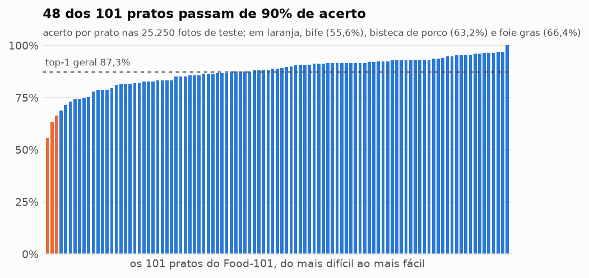

# Qual é o prato?

[](https://github.com/juan-barross/pratos/actions/workflows/ci.yml)

Classificador de pratos por foto: o ConvNeXt-Tiny, pré-treinado no ImageNet, ajustado nas 101 classes do [Food-101](https://huggingface.co/datasets/ethz/food101). É o tipo de modelo que ajuda a organizar cardápio e catálogo a partir das fotos que os restaurantes enviam.

[Testar com uma foto](https://huggingface.co/spaces/juan1211/pratos): o modelo roda no navegador, sem servidor. Top-1 de 87,3% no teste do Food-101, medido no PyTorch; a versão int8 do navegador dá o mesmo palpite em 98,6% de 500 fotos.

- Treino e avaliação: [`notebooks/treino.ipynb`](notebooks/treino.ipynb), numa T4 do Colab.
- Conversão para o navegador: [`notebooks/exportar_onnx.ipynb`](notebooks/exportar_onnx.ipynb) exporta para ONNX com o próprio PyTorch, quantiza as camadas lineares em int8 e confere o resultado contra o PyTorch.
- Modelo: [juan1211/pratos-convnext-tiny-food101](https://huggingface.co/juan1211/pratos-convnext-tiny-food101).
- Demonstração: [`space/`](space/), um Space estático. O modelo roda no navegador de quem visita com o Transformers.js, então não há servidor para dormir nem custo.

## Avaliação

Medida nas 25.250 fotos de teste do Food-101, revisadas à mão pelos autores do dataset. O relatório completo está em [`reports/avaliacao_teste.json`](reports/avaliacao_teste.json).

| Métrica | Valor |
|---|---|
| Top-1 | 87,3% (IC 95% de 86,9% a 87,7%) |
| Top-5 | 97,8% |
| Erro de calibração | 0,043 |
| Latência do PyTorch na CPU do Colab, uma foto (2 vCPUs, 1 thread) | 119 ms (p95 de 175 ms) |
| Treino | 3 épocas, 26,7 min numa T4 |

Quando o modelo tem confiança de pelo menos 0,9, o que acontece em 59% das fotos, ele acerta 99,1%. Num cardápio, dá para aceitar esses palpites direto e mandar o resto para revisão.



Os pratos mais difíceis são bife (55,6%), bisteca de porco (63,2%) e foie gras (66,4%). A confusão mais comum é bife lido como filé mignon (52 fotos), seguida de bolo e mousse de chocolate, nos dois sentidos, e tartare de carne e de atum. São pares que até uma pessoa confunde pela foto.

## Publicar o Space

O modelo precisa estar público e com a pasta `onnx/`, porque o navegador baixa os pesos direto do Hugging Face.

```bash
hf repos create juan1211/pratos --type space --sdk static
hf upload juan1211/pratos space . --repo-type space
```

## Licença

Código sob licença MIT. O modelo publicado no Hugging Face está sob Apache-2.0, e o Food-101 tem a licença dos seus autores.
